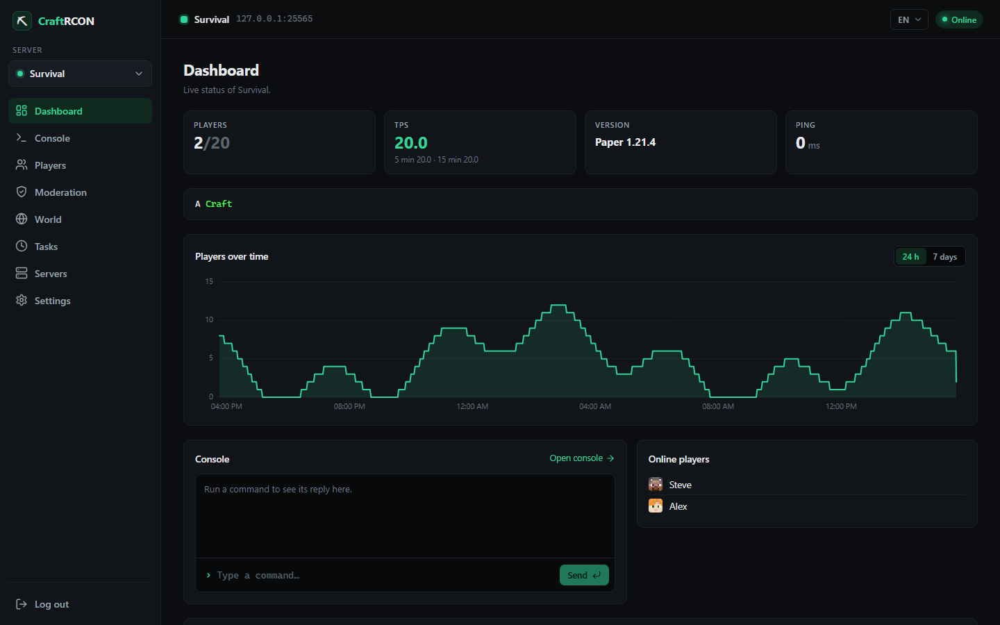
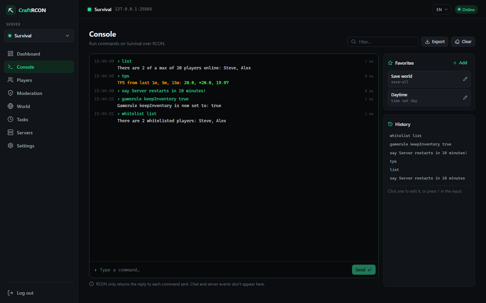
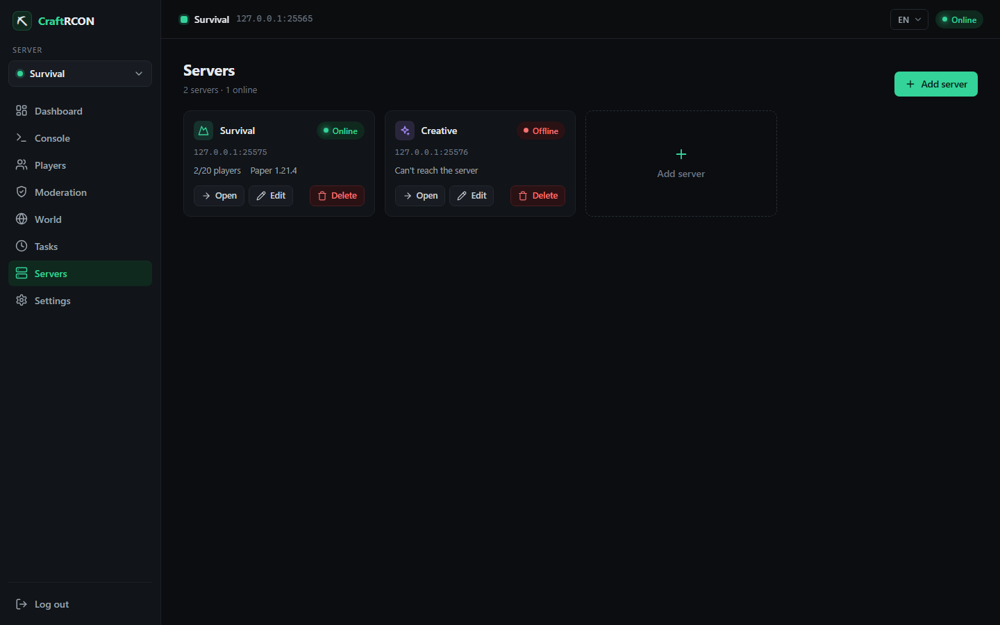
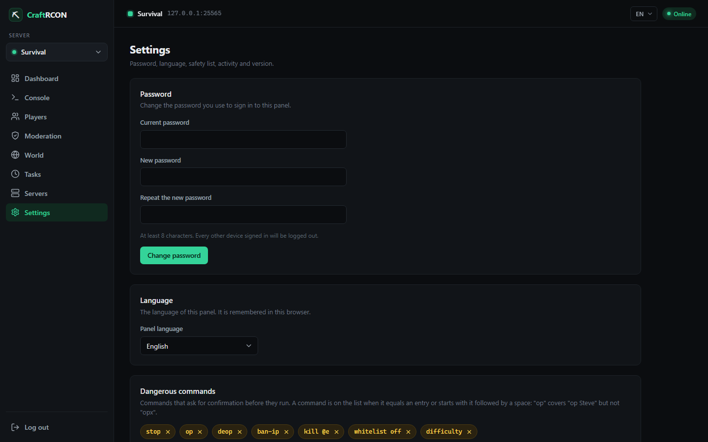

# CraftRCON

[English](README.md) · [Español](README.es.md)

Un panel web para administrar uno o varios servidores de Minecraft por RCON, con consola, dashboard,
herramientas de jugadores y moderación, controles del mundo y tareas programadas. Se instala en
cualquier servidor Linux con dos comandos y funciona por su cuenta: solo se comunica con tus servidores
de Minecraft por red.



- **Servidores:** agrega, edita y elimina servidores desde el panel, con un botón "Probar conexión". El
  instalador no configura ningún servidor.
- **Consola:** salida con colores (códigos `§` y `&`), autocompletado de comandos vanilla y de los
  nombres de los jugadores conectados, historial y favoritos por servidor, filtro y exportación, y una
  confirmación para los comandos peligrosos (`stop`, `op`, `ban-ip`, ...; la lista es editable).
- **Dashboard:** jugadores, versión y software, ping, TPS (Paper, Spigot y Purpur), el MOTD, un gráfico
  de jugadores en el tiempo (24 horas o 7 días) y los jugadores conectados con su cabeza de skin.
- **Jugadores y Moderación:** kick, ban, op, gamemode, teleport, give, mensajes privados, whitelist, y
  bans e IP bans con su motivo.
- **Mundo:** hora, clima, dificultad, gamerules, borde del mundo, `save-all` y anuncios con un editor
  de colores y formato.
- **Tareas:** secuencias de comandos programadas (cada N minutos u horas, o una vez al día a una hora
  fija), con plantillas de autoguardado, mensajes automáticos y avisos de reinicio.
- **Registro de actividad:** cada comando enviado, cada inicio de sesión y cada cambio de servidores, se
  conserva 90 días.
- **Dos idiomas:** inglés (por defecto) y español. Se pueden agregar más sin tocar código
  ([CONTRIBUTING.md](CONTRIBUTING.md)).
- **Sin CDNs:** la interfaz no carga nada de internet y funciona en una red sin salida (las cabezas de
  skin tienen una cabeza genérica de respaldo).

| Consola | Servidores | Ajustes |
| --- | --- | --- |
|  |  |  |

(Las capturas muestran la interfaz en inglés, que es el idioma por defecto; se cambia con el selector
EN/ES de la esquina superior derecha o en Settings.)

## Qué necesitas

- **Un servidor Linux para el panel** (no tiene que ser la máquina que ejecuta Minecraft). x86_64 o
  aarch64, con systemd u OpenRC. El instalador se encarga de Node.js y del resto.
- **Servidores Java Edition con RCON activado.** La conexión funciona con cualquier versión y cualquier
  software que implemente RCON (Vanilla, Paper, Spigot, Purpur, Fabric, Forge). Las funciones
  "inteligentes" (autocompletado, IDs de ítems, gamerules, los parsers de `list`, `banlist` y `tps`,
  `tellraw`) están hechas y probadas para Java 1.16 o posterior. En versiones anteriores la consola y el
  dashboard funcionan, y lo que el panel no sabe interpretar se muestra como la respuesta cruda del
  servidor.
- **No soportado:** Bedrock Edition (no tiene RCON) ni proxies como Velocity o BungeeCord (no tienen RCON
  propio).

### Distribuciones soportadas

| Nivel | Distribuciones |
| --- | --- |
| Probadas | Debian 12 y 13, Ubuntu 22.04 y 24.04, Rocky Linux y AlmaLinux 9, Fedora (el CI ejecuta una instalación y una actualización reales en contenedores de Debian 12, Ubuntu 24.04, Rocky Linux 9 y Fedora) |
| Mejor esfuerzo | openSUSE, Arch Linux, Alpine |

El instalador detecta la distribución con `/etc/os-release`, y si algo no es compatible lo dice y se
detiene antes de cambiar nada.

### Activar RCON en tu servidor de Minecraft

Edita `server.properties` en la máquina de Minecraft y reinicia el servidor:

```properties
enable-rcon=true
rcon.port=25575
rcon.password=elige-una-clave-larga-y-aleatoria
```

Luego agrega el servidor en el panel (Servers, "Add server") con el mismo host, puerto RCON y contraseña, y
pulsa "Test connection". El panel también pide el puerto del juego (25565 por defecto): lo usa para el
estado, la versión, el MOTD y los jugadores, que salen del Server List Ping y no necesitan RCON.

> **No expongas el puerto RCON a internet.** Quien lo alcance y conozca la contraseña puede ejecutar
> cualquier comando en tu servidor, y el protocolo RCON no va cifrado. Bloquea con el firewall el puerto
> 25575 para que solo lo alcance la IP del panel, o pon ambas máquinas en una red privada (VPN). Si el
> panel y el servidor de Minecraft están en la misma máquina, nada de afuera necesita llegar a ese puerto.

## Instalar

En la máquina que ejecutará el panel:

```bash
git clone https://github.com/solqubit/craftrcon.git && cd craftrcon && sudo ./install.sh
```

El instalador pregunta:

1. **La clave del panel** (mínimo 8 caracteres, dos veces y sin mostrarla).
2. **El puerto del panel** (8080 por defecto; si está ocupado propone uno libre).
3. **Un dominio, opcional.** Con dominio configura HTTPS automático (ver abajo).
4. Si `ufw` o `firewalld` están activos, si quieres **abrir el puerto**.

Al terminar muestra la dirección del panel, por ejemplo `http://203.0.113.10:8080`. Con `--lang es` el
instalador habla en español. Para instalaciones sin preguntas, mira `./install.sh --help`
(`--non-interactive` lee `CRAFTRCON_PASSWORD`, `CRAFTRCON_PORT` y `CRAFTRCON_DOMAIN`).

Qué hace, en resumen: instala solo los paquetes del sistema que falten (`git`, `curl`, `tar`), descarga el
Node.js oficial en una carpeta privada (verifica su SHA-256; nunca toca un Node del sistema), copia la
aplicación a `/opt/craftrcon`, crea el usuario de sistema `craftrcon`, guarda los datos en
`/var/lib/craftrcon` y la configuración en `/etc/craftrcon/config.json`, y crea y arranca un servicio
systemd u OpenRC que se inicia con la máquina. Después puedes borrar la carpeta que clonaste.

Si el puerto no es accesible desde afuera, ábrelo también en el firewall de tu proveedor de hosting
(grupo de seguridad).

### HTTPS con dominio, o HTTP simple

- **Con dominio** (por ejemplo `panel.example.com`): el instalador descarga [Caddy](https://caddyserver.com)
  (con el checksum verificado) y lo ejecuta como un segundo servicio delante del panel. Caddy obtiene y
  renueva el certificado solo, y el panel pasa a escuchar solo en localhost. Antes de instalar, el dominio
  ya debe apuntar al servidor (registro DNS A/AAAA) y los puertos 80 y 443 deben estar libres y
  accesibles desde internet.
- **Sin dominio** el panel usa **HTTP simple**: la clave y la cookie de sesión viajan **sin cifrar**. El
  instalador lo advierte. Úsalo solo en una red de confianza (LAN, VPN), o ponlo detrás de un dominio.

## Actualizar

Descarga la versión nueva en cualquier carpeta, entra y ejecuta el actualizador:

```bash
cd /tmp
git clone https://github.com/solqubit/craftrcon.git
cd craftrcon
sudo ./update.sh
```

También sirve un `.zip` descargado, porque la versión se lee del archivo `VERSION` y no de git.

- **Misma versión:** dice "already up to date" y no cambia nada.
- **Versión más nueva:** muestra `anterior → nueva`, pide confirmación (o usa `--yes`) y actualiza.
- **Versión más vieja:** se niega, porque volver atrás puede romper la base de datos.

Antes de reemplazar nada respalda la base de datos y la configuración en
`/var/backups/craftrcon/<fecha>-<versión>/` (fuera de la carpeta de datos; se guardan los últimos 5
respaldos). Luego detiene el servicio, reemplaza la aplicación, ejecuta `npm ci` y lo arranca. Las
migraciones de la base de datos se aplican solas al iniciar. **Si la versión nueva no responde, restaura
sola la versión anterior y el respaldo** y te explica qué pasó. Nunca toca tu clave, la clave de cifrado,
tus servidores guardados ni la configuración (puerto, dominio).

La página Settings muestra la versión instalada y, si la máquina tiene internet, si hay una más nueva en
`main`. Solo informa; la actualización siempre se hace con `./update.sh`.

## Cambiar la clave, reparar, desinstalar

Ejecútalos en el servidor del panel, desde una copia del proyecto:

```bash
sudo ./install.sh --reset-password     # cambia la clave del panel; cierra todas las sesiones abiertas
sudo ./install.sh --uninstall          # quita el panel, pregunta si borrar también los datos
sudo ./install.sh --uninstall --purge  # borra además los datos, el usuario de servicio y los respaldos
sudo ./install.sh                      # con el panel instalado: menú para cambiar la clave,
                                       # reparar el servicio o desinstalar
```

También puedes cambiar la clave desde Settings con la sesión iniciada. `--uninstall` conserva tus datos
(`/var/lib/craftrcon`, con la base de datos y la clave de cifrado) y los respaldos de actualización, salvo
que respondas que sí al borrado o uses `--purge`. Si la copia desde la que ejecutas `./install.sh` es más
nueva que la versión instalada, el menú ofrece ejecutar `./update.sh`.

## Qué limita RCON

RCON es un canal de comandos, no un flujo de registro, así que el panel es honesto sobre lo que no puede
hacer:

- **Sin chat ni registro en vivo del servidor.** RCON solo devuelve la respuesta de cada comando que
  envías. El chat, las entradas, las muertes y otros eventos del servidor no aparecen en la consola, y no
  hay una pestaña "Live log". El panel nunca lee archivos de la máquina de Minecraft.
- **Sin lista de operadores.** RCON vanilla no tiene un comando para listar los ops. Moderation permite
  hacer `op` y `deop` a jugadores, pero no puede mostrar quién ya lo es.
- **No puede iniciar el servidor.** RCON solo llega a un servidor que ya está en marcha. `stop` funciona
  como comando, pero el panel no puede iniciar, crear ni reiniciar el proceso de Minecraft (usa tu gestor
  de servicios para eso).
- **Sin gestión de archivos ni del mundo:** no hay gestor de archivos, instalador de plugins o mods,
  editor de `server.properties` ni respaldos del mundo.
- **TPS** solo se muestra cuando existe el comando `tps` (Paper, Spigot, Purpur).

Como el panel es independiente de la máquina de Minecraft y solo usa la red (RCON y Server List Ping),
"Offline" significa que el panel no puede alcanzar el servidor, no necesariamente que el servidor esté
caído. Cambiar el host o el puerto RCON de un servidor guardado exige escribir otra vez su contraseña
RCON, para que la contraseña guardada nunca se envíe a otra dirección.

## Seguridad

CraftRCON está pensado para estar expuesto a internet; estas son las medidas que toma y qué protegen y qué
no.

- **Una sola clave de administrador**, guardada como hash scrypt. El servicio corre como el usuario de
  sistema `craftrcon`, sin privilegios, no como root, y (con systemd) con `NoNewPrivileges`, un sistema de
  archivos de solo lectura salvo su carpeta de datos y un `/tmp` privado.
- **Sesiones:** cookie `HttpOnly` y `SameSite=Strict` (también `Secure` cuando hay dominio con HTTPS),
  expira tras 7 días sin uso, con botón "Log out".
- **Fuerza bruta:** los intentos de inicio de sesión se limitan por IP, con un bloqueo temporal que se
  alarga en cada bloqueo repetido.
- **CSRF:** `SameSite=Strict` más una verificación de `Origin` en cada petición que modifica datos.
- **Las contraseñas RCON se guardan cifradas** con AES-256-GCM. La clave es un archivo creado en la
  instalación (`/var/lib/craftrcon/secret.key`, modo `0600`, legible solo por el usuario del servicio) y
  la API nunca devuelve las contraseñas, ni siquiera cifradas: no llegan al navegador.
  **Qué protege:** la filtración del archivo de la base de datos o de un respaldo suyo, que sin la clave
  no sirve (los respaldos de actualización no incluyen la clave). **Qué no protege:** quien controle la
  máquina del panel, el usuario `craftrcon` o root puede leer la clave y la base de datos, y el propio
  panel debe descifrar las contraseñas para conectarse. La máquina es el límite de confianza.
- **HTTP sin dominio expone la clave** y la sesión a cualquiera en el camino. Usa un dominio con HTTPS
  siempre que el panel sea accesible fuera de una red de confianza.
- **Los comandos se envían tal cual se escriben.** No hay ejecución en el sistema operativo del panel,
  solo comandos RCON a tus servidores de Minecraft; se rechazan los comandos con saltos de línea o más
  largos que el límite de RCON.
- **RCON en sí no va cifrado** y es una contraseña compartida: mantenlo fuera de internet (ver arriba).
- **Conexiones salientes:** las cabezas de skin (el backend del panel las pide a `mc-heads.net` y las
  guarda en caché) y la comprobación opcional de versión contra `raw.githubusercontent.com`. Ambas son
  opcionales y fallan en silencio.

¿Encontraste una vulnerabilidad? Repórtala en privado a los mantenedores en vez de abrir un issue
público.

## Solución de problemas

- Registros del servicio: `journalctl -u craftrcon -n 100` (systemd) o `/var/log/craftrcon.log`
  (OpenRC).
- Estado del servicio: `systemctl status craftrcon` (systemd) o `rc-service craftrcon status` (OpenRC).
- Olvidaste la clave: `sudo ./install.sh --reset-password`.
- "Connection refused" al probar un servidor: RCON está apagado (`enable-rcon=true`), el puerto es otro o
  un firewall lo bloquea. "Wrong password": debe coincidir con `rcon.password`.

## Desarrollo

Node.js 22.13 o posterior (el panel usa el `node:sqlite` integrado).

```bash
npm ci
npm run fake-mc   # un servidor de Minecraft falso: RCON en 25575 (clave "dev"), puerto de juego 25565
npm start         # el panel en http://localhost:8080 (configuración con CRAFTRCON_CONFIG, ver src/config.js)
npm test          # pruebas del panel
npm run test:shell  # pruebas unitarias del instalador (bash)
```

El backend es Fastify con SQLite y sin dependencias nativas; la interfaz es una SPA sin paso de
compilación (Preact y htm, incluidos en `public/vendor`). Lee [CONTRIBUTING.md](CONTRIBUTING.md) antes de
abrir un pull request.

## Licencia

[MIT](LICENSE)
