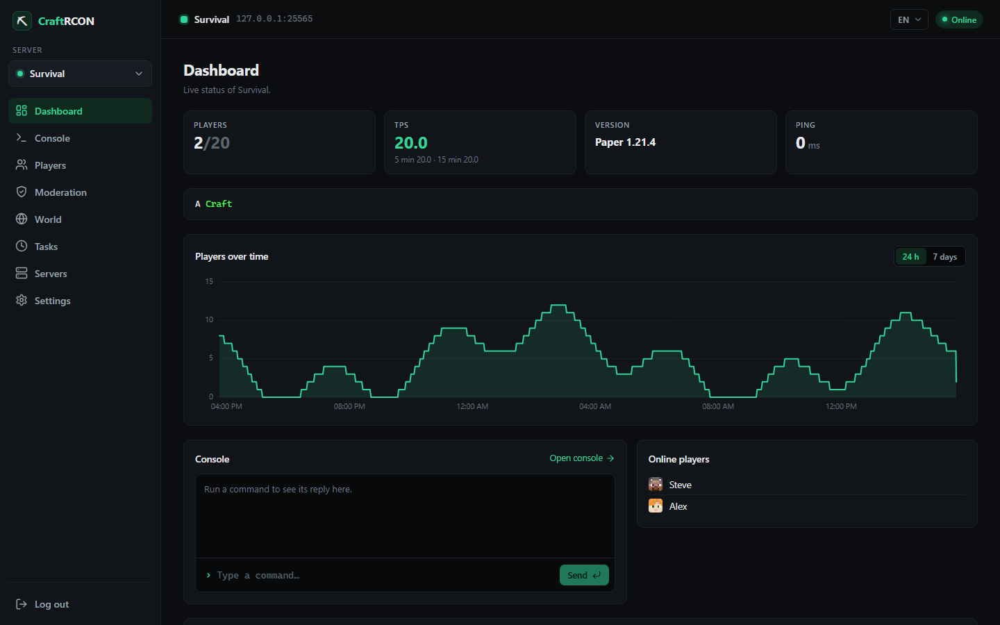
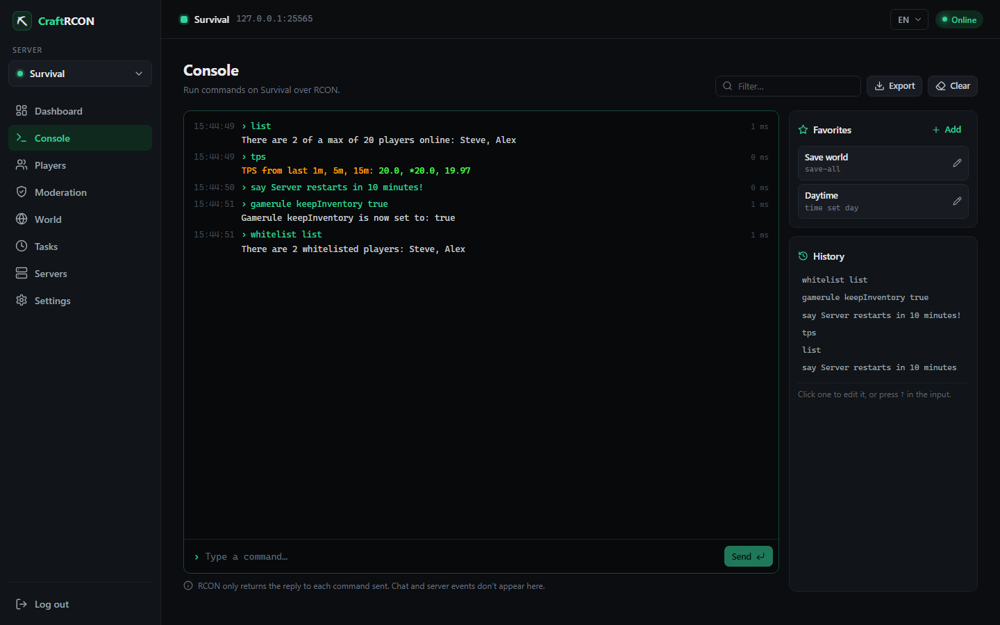
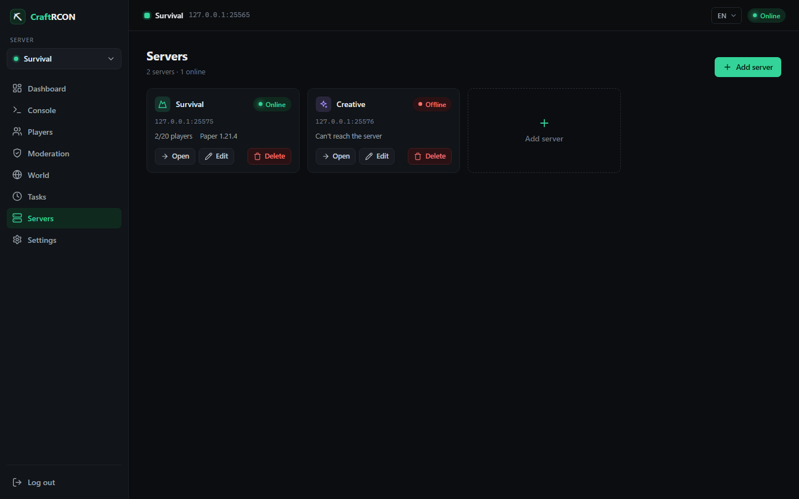
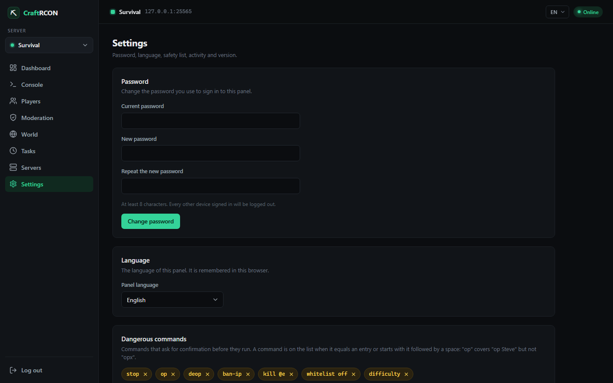

# CraftRCON

[English](README.md) · [Español](README.es.md)

A web panel to administer one or several Minecraft servers over RCON, with a console, a dashboard,
player and moderation tools, world controls and scheduled tasks. It installs on any Linux server
with two commands and runs on its own: it only talks to your Minecraft servers over the network.



- **Servers:** add, edit and delete servers in the panel, with a "Test connection" button. Nothing is
  configured in the installer.
- **Console:** colored output (`§` and `&` codes), autocomplete for vanilla commands and online player
  names, command history and favorites per server, filter and export, and a confirmation step for
  dangerous commands (`stop`, `op`, `ban-ip`, ...; the list is editable).
- **Dashboard:** players, version and software, ping, TPS (Paper, Spigot and Purpur), the MOTD, a
  players-over-time chart (24 hours or 7 days) and the online players with their skin heads.
- **Players and Moderation:** kick, ban, op, gamemode, teleport, give, private messages, whitelist, and
  bans and IP bans with their reasons.
- **World:** time, weather, difficulty, gamerules, world border, `save-all`, and announcements with a
  color and format editor.
- **Tasks:** scheduled command sequences (every N minutes or hours, or once a day at a fixed time), with
  templates for autosave, automatic messages and restart warnings.
- **Activity log:** every command sent, every login and every server change, kept for 90 days.
- **Two languages:** English (default) and Spanish. More can be added without touching code
  ([CONTRIBUTING.md](CONTRIBUTING.md)).
- **No CDNs:** the interface loads nothing from the internet and works on a network without outbound
  access (skin heads fall back to a generic head).

| Console | Servers | Settings |
| --- | --- | --- |
|  |  |  |

## What you need

- **A Linux server for the panel** (it does not have to be the machine that runs Minecraft). x86_64 or
  aarch64, with systemd or OpenRC. The installer takes care of Node.js and everything else.
- **Java Edition servers with RCON enabled.** The connection works with any version and any software that
  implements RCON (Vanilla, Paper, Spigot, Purpur, Fabric, Forge). The "smart" features (autocomplete,
  item IDs, gamerules, the `list`, `banlist` and `tps` parsers, `tellraw`) are built and tested for
  Java 1.16 and later. On older versions the console and the dashboard still work, and anything the panel
  cannot interpret is shown as the raw server reply.
- **Not supported:** Bedrock Edition (it has no RCON) and proxies such as Velocity or BungeeCord (they have
  no RCON of their own).

### Supported distributions

| Level | Distributions |
| --- | --- |
| Tested | Debian 12 and 13, Ubuntu 22.04 and 24.04, Rocky Linux and AlmaLinux 9, Fedora (the CI runs a real install and update in containers of Debian 12, Ubuntu 24.04, Rocky Linux 9 and Fedora) |
| Best effort | openSUSE, Arch Linux, Alpine |

The installer detects the distribution through `/etc/os-release`, and if something is not supported it
says so and stops before changing anything.

### Enable RCON on your Minecraft server

Edit `server.properties` on the Minecraft machine, then restart the server:

```properties
enable-rcon=true
rcon.port=25575
rcon.password=choose-a-long-random-password
```

Then add the server in the panel (Servers, "Add server") with the same host, RCON port and password, and
press "Test connection". The panel also asks for the game port (25565 by default): it uses it for the
status, version, MOTD and player count, which come from the Server List Ping and do not need RCON.

> **Do not expose the RCON port to the internet.** Anyone who reaches it and knows the password can run any
> command on your server, and the RCON protocol is not encrypted. Firewall port 25575 so that only the
> panel's IP address can reach it, or put both machines on a private network (VPN). If the panel and the
> Minecraft server run on the same machine, nothing outside needs to reach that port at all.

## Install

On the machine that will run the panel:

```bash
git clone https://github.com/solqubit/craftrcon.git && cd craftrcon && sudo ./install.sh
```

The installer asks for:

1. **The panel password** (at least 8 characters, typed twice and never shown).
2. **The panel port** (8080 by default; if it is busy it proposes a free one).
3. **A domain, optional.** With a domain it sets up automatic HTTPS (see below).
4. If `ufw` or `firewalld` is active, whether to **open the port**.

When it finishes it prints the address of the panel, for example `http://203.0.113.10:8080`. Add
`--lang es` to get the installer in Spanish. For unattended installs, see
`./install.sh --help` (`--non-interactive` reads `CRAFTRCON_PASSWORD`, `CRAFTRCON_PORT` and
`CRAFTRCON_DOMAIN`).

What it does, in short: installs only the missing system packages (`git`, `curl`, `tar`), downloads the
official Node.js into a private folder (SHA-256 verified; it never touches a Node of your system),
copies the application to `/opt/craftrcon`, creates the `craftrcon` system user, keeps the data in
`/var/lib/craftrcon` and the configuration in `/etc/craftrcon/config.json`, and creates and starts a
systemd or OpenRC service that starts with the machine. The folder you cloned can be deleted afterwards.

If the port is not reachable from outside, also open it in your hosting provider's firewall (security
group).

### HTTPS with a domain, or plain HTTP

- **With a domain** (for example `panel.example.com`): the installer downloads [Caddy](https://caddyserver.com)
  (checksum verified) and runs it as a second service in front of the panel. Caddy gets and renews the
  certificate automatically, and the panel then listens on localhost only. Before installing, the domain
  must already point to the server (a DNS A/AAAA record) and ports 80 and 443 must be free and reachable
  from the internet.
- **Without a domain** the panel uses **plain HTTP**: the password and the session cookie travel
  **unencrypted**. The installer warns about it. Use it only on a trusted network (LAN, VPN), or put it
  behind a domain.

## Update

Download the new version into any folder, enter it and run the updater:

```bash
cd /tmp
git clone https://github.com/solqubit/craftrcon.git
cd craftrcon
sudo ./update.sh
```

A downloaded `.zip` works as well, since the version is read from the `VERSION` file and not from git.

- **Same version:** it says "already up to date" and changes nothing.
- **Newer version:** it shows `old → new`, asks for confirmation (or use `--yes`) and updates.
- **Older version:** it refuses, because going back can break the database.

Before replacing anything it backs up the database and the configuration to
`/var/backups/craftrcon/<date>-<version>/` (outside the data folder; the last 5 backups are kept). It then
stops the service, replaces the application, runs `npm ci` and starts it again. Database migrations are
applied automatically on start. **If the new version does not answer, it restores the previous version and
the backup by itself** and tells you what happened. It never touches your password, the encryption key,
your saved servers or the configuration (port, domain).

The Settings page shows the installed version and, when the machine has internet access, whether a newer
one is available on `main`. It only informs; the update is always done with `./update.sh`.

## Change the password, repair, uninstall

Run these on the panel's server, from a copy of the project:

```bash
sudo ./install.sh --reset-password     # change the panel password; it closes every open session
sudo ./install.sh --uninstall          # remove the panel, it asks whether to delete the data too
sudo ./install.sh --uninstall --purge  # also delete the data, the service user and the update backups
sudo ./install.sh                      # on an installed panel: menu to change the password,
                                       # repair the service or uninstall
```

You can also change the password from Settings while you are signed in. `--uninstall` keeps your data
(`/var/lib/craftrcon`, with the database and the encryption key) and the update backups unless you answer
yes to deleting them, or pass `--purge`. If the copy you run `./install.sh` from is newer than the
installed version, the menu offers to run `./update.sh`.

## What RCON limits

RCON is a command channel, not a log stream, so the panel is honest about what it cannot do:

- **No chat and no live server log.** RCON only returns the reply to each command you send. Chat messages,
  joins, deaths and other server events do not appear in the console, and there is no "Live log" tab. The
  panel never reads files from the Minecraft machine.
- **No list of operators.** Vanilla RCON has no command to list ops. Moderation lets you `op` and `deop`
  players, but it cannot show who already is one.
- **It cannot start the server.** RCON only reaches a running server. `stop` works as a command, but the
  panel cannot start, create or restart the Minecraft process (use your service manager for that).
- **No file or world management:** no file manager, plugin or mod installer, `server.properties` editor or
  world backups.
- **TPS** is only shown when the `tps` command exists (Paper, Spigot, Purpur).

Because the panel is independent of the Minecraft machine and only uses the network (RCON and Server List
Ping), "Offline" means that the panel cannot reach the server, not necessarily that the server is down.
Changing a saved server's host or RCON port requires typing its RCON password again, so that the saved
password is never sent to a different address.

## Security

CraftRCON is meant to be exposed to the internet, so these are the measures it takes and what they do and
do not protect.

- **One administrator password**, stored as an scrypt hash. The service runs as the unprivileged
  `craftrcon` system user, not as root, and (on systemd) with `NoNewPrivileges`, a read-only file system
  except its data folder, and a private `/tmp`.
- **Sessions:** `HttpOnly` and `SameSite=Strict` cookie (also `Secure` when a domain with HTTPS is set),
  expiring after 7 days without use, with a "Log out" button.
- **Brute force:** login attempts are limited per IP, with a temporary lock that gets longer on each
  repeated lock.
- **CSRF:** `SameSite=Strict` plus an `Origin` check on every request that changes data.
- **RCON passwords are encrypted at rest** with AES-256-GCM. The key is a file created at install time
  (`/var/lib/craftrcon/secret.key`, mode `0600`, readable only by the service user) and the passwords
  are never sent back by the API, not even encrypted: they never reach the browser.
  **What this protects:** a leak of the database file or of a backup of it, which is useless without the key
  (the update backups do not include the key). **What it does not protect:** an attacker with control of
  the panel machine, or of the `craftrcon` user or root, can read the key and the database, and the panel
  itself has to decrypt the passwords to connect. Treat the machine as the trust boundary.
- **HTTP without a domain exposes the password** and the session to anyone on the path. Use a domain with
  HTTPS whenever the panel is reachable outside a trusted network.
- **Commands are sent as typed.** There is no execution on the panel's operating system, only RCON commands
  to your Minecraft servers; commands with line breaks or longer than the RCON limit are rejected.
- **RCON itself is unencrypted** and a shared password: keep it off the public internet (see above).
- **Outbound connections:** skin heads (the panel's backend asks `mc-heads.net` and caches them), and the
  optional version check against `raw.githubusercontent.com`. Both are optional and fail silently.

Found a vulnerability? Please report it privately to the maintainers instead of opening a public issue.

## Troubleshooting

- Service logs: `journalctl -u craftrcon -n 100` (systemd) or `/var/log/craftrcon.log` (OpenRC).
- Service status: `systemctl status craftrcon` (systemd) or `rc-service craftrcon status` (OpenRC).
- Forgot the password: `sudo ./install.sh --reset-password`.
- "Connection refused" when testing a server: RCON is off (`enable-rcon=true`), the port is wrong, or a
  firewall blocks it. "Wrong password": it must match `rcon.password`.

## Development

Node.js 22.13 or later (the panel uses the built-in `node:sqlite`).

```bash
npm ci
npm run fake-mc   # a fake Minecraft server: RCON on 25575 (password "dev"), game port 25565
npm start         # the panel on http://localhost:8080 (config via CRAFTRCON_CONFIG, see src/config.js)
npm test          # panel tests
npm run test:shell  # installer unit tests (bash)
```

The backend is Fastify with SQLite and no native dependencies; the interface is a no-build single-page
app (Preact and htm, included in `public/vendor`). See [CONTRIBUTING.md](CONTRIBUTING.md) before opening
a pull request.

## License

[MIT](LICENSE)
